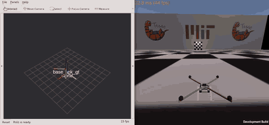

# VNAV Labs (ROS 1)

Labs of MIT 16.485 *Visual Navigation for Autonomous Vehicles*, done with ROS 1 Noetic on Ubuntu 20.04 and the MIT starter code (tag `VNAV2021`).

## LAB3: 3D Trajectory Following

Geometric tracking controller on SE(3) (Lee et al., 2010) for a simulated quadrotor that follows a circle of radius 5 m at 2.5 m/s in the TESSE simulator. Left: RViz; right: simulator window (preview at 4× speed, click for the full video).

Full video (40 s): [`lab3/results/lab3_rviz_sim_side_by_side.mp4`](lab3/results/lab3_rviz_sim_side_by_side.mp4)

With the final gains (kx = 10, kv = 5, kR = 30, kω = 2.5) the drone settles on the circle 1.8 s after take-off and then tracks it with an 8.6 mm position error and a 2.35° heading lag; a hover step overshoots by 1 %.

| Folder | Content |
|---|---|
| [`lab3/lab3要求.md`](lab3/lab3要求.md) | Requirements of the lab |
| [`lab3/code`](lab3/code) | Code for an Apple-silicon Mac (Ubuntu 20.04 arm64 virtual machine, simulator through box64) |
| [`lab3/codeforWindows`](lab3/codeforWindows) | Code for Windows (WSL2 Ubuntu 20.04, x86-64) |
| [`lab3/deliverable12answer`](lab3/deliverable12answer) | Answers to Deliverables 1 and 2 |
| [`lab3/results`](lab3/results) | Flight video |

## LAB4: UAV Control and Racing

Minimum-snap trajectories through the 12 gates of a race course (`mav_trajectory_generation`), flown by the LAB3 controller in the TESSE simulator. Videos: RViz on the left, simulator window on the right, real time.

- Stable final run, 40.9 s: [`lab4/results/lab4_stable_rviz_sim.mp4`](lab4/results/lab4_stable_rviz_sim.mp4). With vmax = 10 m/s, amax = 12 m/s2 and the desired state published at 100 Hz, the drone passes every gate within 1.7 cm of its centre. One via point between gates 9 and 10 keeps it 3.0 m from the wall in that turn.
- Racing run (optional extra credit), 10.2 s: [`lab4/results/lab4_racing_rviz_sim.mp4`](lab4/results/lab4_racing_rviz_sim.mp4). Segment times are chosen under acceleration limits, with a 5 m run-out after the last gate. The drone passes all 12 gates and reaches 15 m/s (MIT record: 10.3 s).

| Folder | Content |
|---|---|
| [`lab4/lab4要求.md`](lab4/lab4要求.md) | Requirements of the lab |
| [`lab4/code`](lab4/code) | Code (Part 0, Parts 1.1-1.3, the via-point copy used for the final run, scripts) for an Apple-silicon Mac (Ubuntu 20.04 arm64 virtual machine, simulator through box64) |
| [`lab4/codeforRacing`](lab4/codeforRacing) | Racing version: time allocation under acceleration limits and run-out after the last gate |
| [`lab4/deliverable12answer`](lab4/deliverable12answer) | Answers to Deliverables 1 and 2 |
| [`lab4/results`](lab4/results) | Flight videos |
